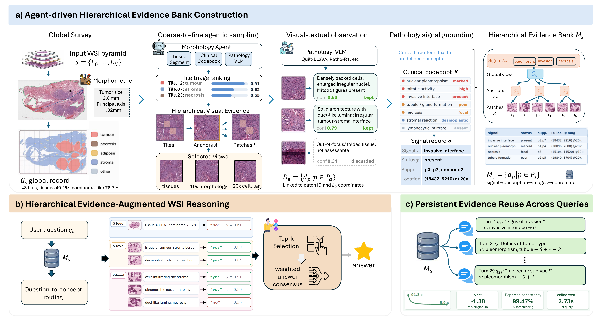

<h1 align="center">SlideBank</h1>

<p align="center"><strong>A Persistent Hierarchical Evidence Bank for Consistent Whole-Slide Reasoning</strong></p>

<p align="center">
  Beidi Zhao · Gexin Huang · Ciro Zhang · Anqi Li · Yusheng Tan · Chen Zhou · Gang Wang · Zu-hua Gao · Xiaoxiao Li
</p>

<p align="center"><strong>Accepted at WACV</strong></p>

<p align="center">
  <a href="https://arxiv.org/abs/2609.00342">Paper</a> ·
  <a href="https://gexinh.github.io/SlideBank/">Project Page</a> ·
  <a href="#interactive-workbench">Interactive Workbench</a> ·
  <a href="#citation">Citation</a>
</p>

SlideBank separates whole-slide exploration from question answering. It builds a persistent evidence bank with global summaries, regional observations, and patch views, linked through pathology concepts and slide coordinates. The bank can then be reused to retrieve relevant evidence for successive questions.

This repository contains the clean Python backend, the latest V5 Gradio workbench, and an interactive project page.

<p align="center">
  <a href="assets/main-figure.pdf"></a>
</p>

<!-- main-figure-caption:start -->
*Main figure from the SlideBank paper. [Original PDF](assets/main-figure.pdf).*
<!-- main-figure-caption:end -->

The original figure PDF is included above. See [the asset guide](assets/README.md) for updating the README and project-page images.

## Installation

Use Python 3.10 or newer. From the repository root:

```bash
python -m venv .venv
source .venv/bin/activate
python -m pip install -e ".[ui,wsi]"
```

The `wsi` extra includes OpenSlide's Python bindings and bundled library; if your platform needs a system installation, follow the [OpenSlide installation guide](https://openslide.org/download/). Install `.[local]` for local model inference or `.[gemini]` for the Gemini API. Quilt-LLaVA additionally needs its external runtime repository and model weights; use `configs/build_quilt.yaml` and `configs/infer_quilt.yaml` after setting `SLIDEBANK_QUILT_LLAVA_REPO`.

Model weights, benchmark datasets, WSIs, and precomputed private banks are obtained separately. The static project page can be previewed without installing the Python package.

## Build, retrieve, and answer

Edit [configs/build.yaml](configs/build.yaml) and [configs/infer.yaml](configs/infer.yaml) with your slide, bank, artifact, endpoint, and model settings. Their API model name is a placeholder to replace before running. CSV inputs use `Slide`, `Question`, `A`, `B`, `C`, and `D`; optional `Answer` or `GT` columns provide evaluation labels, and `Image` can identify a thumbnail. The templates use the recursive slide search pattern `**/*.svs`; the CLI fallback is `*/*.svs`. See [the data guide](docs/DATA.md) for the matching and bank schemas.

```bash
# Build a bank for one slide before processing the remaining collection.
python scripts/build_bank.py --config configs/build.yaml --max-slides 1

# Run one MCQ through the command-line inference pipeline.
python scripts/infer.py --config configs/infer.yaml --max-samples 1

# Export a bank for the evidence browser.
python scripts/export_ui_tree.py --bank-dir /path/to/bank \
  --out-dir outputs/ui_tree
```

Bank construction writes persistent records and visual artifacts. Inference writes JSONL predictions and a summary to the paths in the inference config. API backends accept credentials through environment variables; set the corresponding `api_key_env` field in the config.

Use `--help` on each script to inspect runtime overrides. Supported inference backends include Quilt-LLaVA, local Hugging Face models, and Gemini/OpenAI/OpenAI-compatible APIs; model compatibility depends on the selected runtime.

## Interactive workbench

```bash
python app.py
```

Open **http://127.0.0.1:7864** to use the latest V5 workbench. Configure the runtime, load an exported evidence bank, browse global/region/patch views, and submit a question. For a remote server, forward port 7864 through SSH or your editor.

The UI and batch CLI expose different inference paths:

| Entry point | Retrieval and answer flow |
| --- | --- |
| `app.py` | V5 question policy, agent routing with rule fallback, selected compact evidence context, and a final VLM answer. Supports free-form and multiple-choice questions. |
| `scripts/infer.py` | Batch MCQ inference using the tool-context retrieval pipeline; `single` and `multi` modes control whether previous answers enter the prompt. |

The clean release has not undergone a full benchmark reproduction. The paper's confidence-based cross-level consensus and reported benchmark results should not be assumed to match these entry points. See [release notes](docs/RELEASE_SUMMARY.md) for scope and validation.

## Project page

The static site source is in [project/](project/). It includes a browser-local evidence viewer for exported JSON and an optional embedded Gradio workbench. Preview it locally:

```bash
python -m http.server --directory project 8080
```

Open **http://127.0.0.1:8080**, or visit the [project page](https://gexinh.github.io/SlideBank/). The Gradio workbench runs as a separate Python service; a static host cannot execute model inference. See [project-page setup](docs/PROJECT_PAGE.md) for the included Pages workflow and hosted-demo configuration.

## Repository layout

```text
app.py          Latest V5 interactive workbench
slidebank/      Bank construction, retrieval, VLM adapters, and UI support
scripts/        Build, inference, UI-tree export, and figure preparation
configs/        Portable configuration templates
project/        Static project page
assets/         Original paper main figure and web preview
docs/           Data contract, release notes, and source attribution
```

## Citation

If you use SlideBank in your research, please cite the paper:

```bibtex
@article{zhao2026slidebank,
  title   = {SlideBank: A Persistent Hierarchical Evidence Bank for Consistent Whole-Slide Reasoning},
  author  = {Zhao, Beidi and Huang, Gexin and Zhang, Ciro and Li, Anqi and Tan, Yusheng and Zhou, Chen and Wang, Gang and Gao, Zu-hua and Li, Xiaoxiao},
  journal = {arXiv preprint arXiv:2609.00342},
  year    = {2026},
  doi     = {10.48550/arXiv.2609.00342},
  url     = {https://arxiv.org/abs/2609.00342}
}
```

The citation uses the current arXiv metadata; conference bibliographic details can be updated when the proceedings entry is available.

## Acknowledgments and licensing

The backend retains WSI processing and evidence-bank components from the authors' WSIChat development code and uses external model and imaging libraries. Original SlideBank contributions are available under the [MIT License](LICENSE). Inherited WSIChat components have separate provenance and their license remains to be confirmed; see [THIRD_PARTY.md](docs/THIRD_PARTY.md) for the affected paths and scope. Model weights, datasets, and paper assets retain their respective terms.
